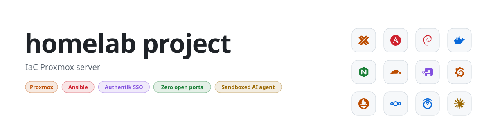
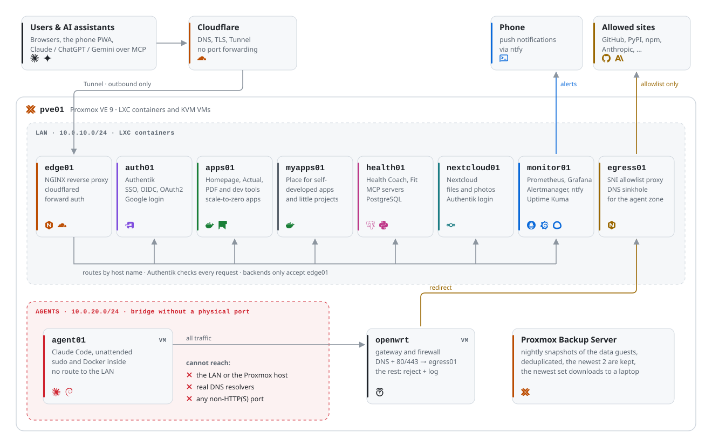
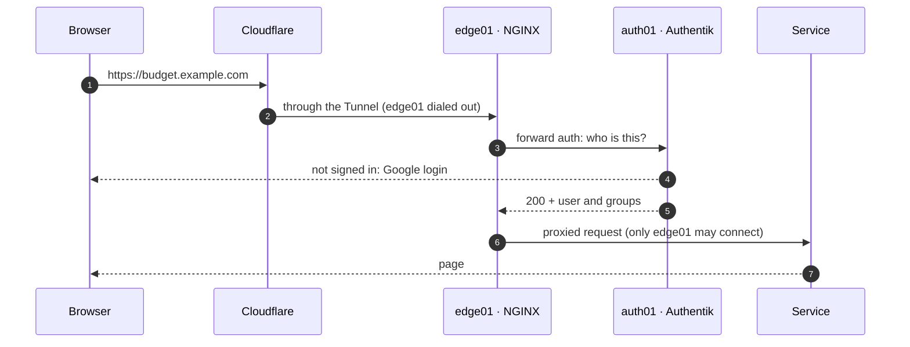
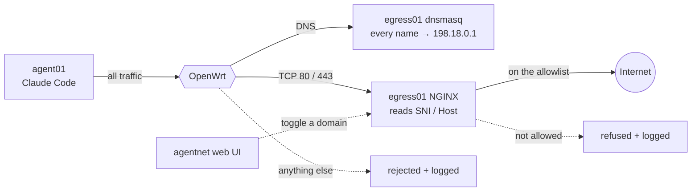

<picture>
  <source media="(prefers-color-scheme: dark)" srcset="assets/banner-dark.svg">
  
</picture>

<p align="center">
  <a href="https://github.com/diamond447/homelab-showcase/actions/workflows/ci.yml"></a>
  
  
  
  
  
  <br>
  
  
  
  
  
  
</p>

<p align="center">
  <b>11</b> hosts &nbsp;·&nbsp; <b>24</b> Ansible roles &nbsp;·&nbsp; <b>16</b> web services &nbsp;·&nbsp; <b>0</b> open ports &nbsp;·&nbsp; <b>1</b> command to rebuild
</p>

## Architecture

<picture>
  <source media="(prefers-color-scheme: dark)" srcset="assets/architecture-dark.svg">
  
</picture>

| | |
|---|---|
| 🧱 **Everything as code** | `ansible-playbook site.yml` creates the containers and VMs through the Proxmox API and configures them. Reruns are idempotent. |
| 🔒 **No open ports** | The internet comes in only through an outbound Cloudflare Tunnel. Backends accept connections from the edge proxy only. |
| 🪪 **One login** | Authentik (Google sign-in) guards every service, by forward auth at the edge or by OIDC (Grafana, Nextcloud, Actual). One service list drives NGINX, Authentik and the uptime monitors. |
| 💤 **Scale to zero** | Rarely used apps sleep. Sablier starts them on the first request and stops them after 15 idle minutes. |
| 💾 **Backups** | Proxmox Backup Server takes deduplicated nightly snapshots and keeps the newest 2. One script downloads the newest set to a laptop. |
| 📈 **Alerts on the phone** | Prometheus, Grafana, Alertmanager and Uptime Kuma, with pushes through a self-hosted ntfy. Disks, thin pool, guests and backups are watched. |
| ❤️ **Health stack** | My [health-coach](https://github.com/diamond447/health-coach) project runs here: wearable data, an MCP server for AI coaching and a stats PWA, plus the openGym tracker for friends and family. |
| 🤖 **Sandboxed AI agent** | Claude Code works unattended in a VM that can reach only an allowlist of sites. |

## How a request gets in



## The agent sandbox



- No route to the LAN or the Proxmox host, not even over IPv6 link-local or ARP.
- DNS answers are fake, so DNS cannot carry data out.
- The proxy connects to the host name itself, so one allowlist entry covers its CDN.

## Repository

```
ansible/
  playbooks/   provision.yml (Proxmox API + bootstrap), configure.yml (roles), site.yml (both)
  roles/       24 roles: edge, authentik, on_demand_apps, egress_proxy, prometheus, ...
  inventory/   hosts, versions and the service list
  vars/        container and VM definitions, vault.example.yml
docs/          architecture, backups and the agent sandbox
```

Read more:

- [Architecture](docs/architecture.md): hosts, the request path, sign-in, on-demand apps and monitoring
- [The agent sandbox](docs/agent-vm.md): network isolation, the egress allowlist and how to change it
- [Backups](docs/backups.md): what is backed up, least-privilege tokens and the restore steps

<sub>A sanitized copy of my private infrastructure repository: the domain, addresses, IDs and allowlist are replaced and the encrypted vault is left out (see <code>ansible/vars/vault.example.yml</code>).</sub>

<sub>MIT licensed, see <a href="LICENSE">LICENSE</a>.</sub>
